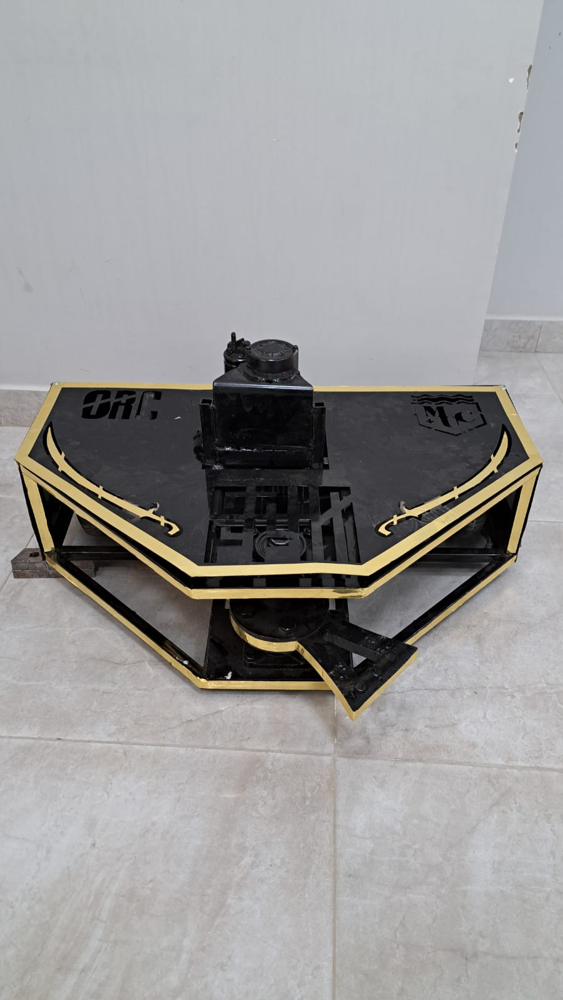
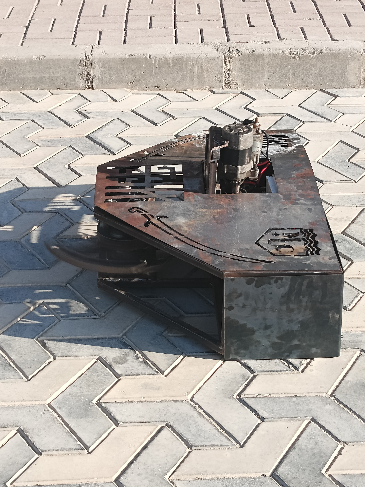
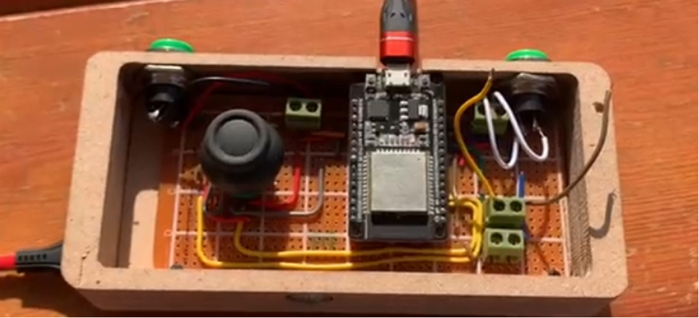
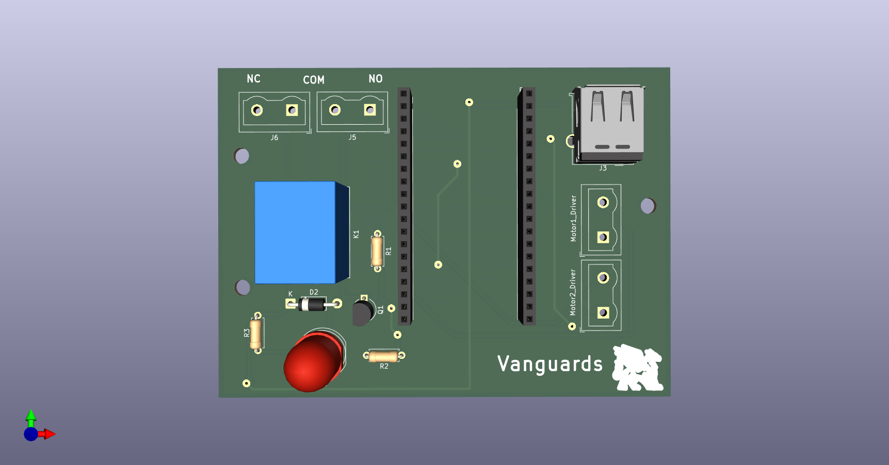
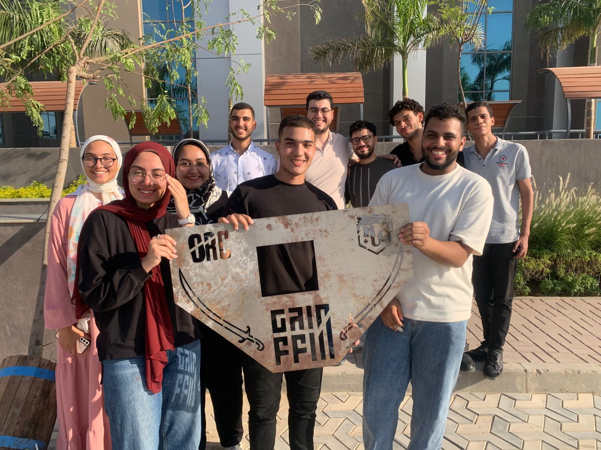

<p align="center">
  
</p>

<p align="center">
  <b>A team-built combat robot. An engineering journey since 2023.</b><br>
  Mechanical fabrication, custom electronics, and ESP-NOW control.
</p>

<p align="center">
  <a href="mechanical/README.md">Mechanical</a> &nbsp;·&nbsp;
  <a href="firmware/README.md">Firmware</a> &nbsp;·&nbsp;
  <a href="electrical/README.md">Electrical</a> &nbsp;·&nbsp;
  <a href="docs/history/README.md">Our story</a> &nbsp;·&nbsp;
  <a href="docs/history/videos/first-integrated-operation.mp4">Watch the first run</a>
</p>

---

## Meet Metal Monster

We have been working on **Metal Monster since 2023**: a manually controlled robot built for robot-versus-robot competition. Two wheelchair motors move the base, while a starter motor powers its metal spinner. A handheld remote communicates with an onboard **ESP32 DevKitC V4** over **ESP-NOW**.

<table>
<tr>
<td width="50%" align="center"><br><b>The painted robot</b></td>
<td width="50%" align="center"><br><b>Before paint and later modifications</b></td>
</tr>
</table>

<p align="center">
  <a href="docs/history/videos/first-integrated-operation.mp4"><b>▶ Watch or download our first integrated-operation video</b></a><br>
  <sub>A milestone identified by the team: the first time the robot worked together as a complete system.</sub>
</p>

## Explore the build

| Area | What you will find | Availability |
| :--- | :--- | :--- |
| **[Mechanical](mechanical/README.md)** | Robot photos, motor references, and a home for CAD and drawings | Photos included · CAD to come |
| **[Firmware](firmware/README.md)** | Separate ESP-NOW remote and receiver sketches, setup notes, and known issues | Source included |
| **[Robot receiver](electrical/receiver/README.md)** | KiCad project, schematic, PCB, Gerbers, drill files, and renders | Design package included |
| **[Handheld remote](electrical/remote/README.md)** | Controller overview, input mapping, and prototype photo | Circuit design files to come |
| **[Project history](docs/history/README.md)** | Early electronics, team photo, and first-operation video | Media included |

## Two circuits. One robot.

<table>
<tr><td width="50%" align="center"><b>HANDHELD REMOTE</b><br><sub>Manual inputs → ESP-NOW commands</sub></td><td width="50%" align="center"><b>ONBOARD RECEIVER</b><br><sub>ESP-NOW commands → motor and relay control</sub></td></tr>
<tr>
<td align="center"></td>
<td align="center"></td>
</tr>
<tr><td>The early remote prototype reads joystick and switch inputs. Its firmware is included; editable remote circuit designs are still to be added.</td><td>The supplied custom PCB hosts the ESP32 DevKitC V4 and interfaces with the drive controller and spinner relay.</td></tr>
</table>

## Hardware at a glance

| | Drive system | Spinner system |
| :--- | :--- | :--- |
| **Motor** | Two wheelchair motors | Starter motor driving a metal spinner |
| **Control** | MDD20A motor driver | BC338 transistor stage and relay |
| **Battery** | **24 V · 20 Ah** lithium-ion | **11.1 V · 3S · 10.4 Ah** LiPo |
| **Reference** | [Drive battery](electrical/receiver/images/drive-battery-reference.png) | [Battery listing](electrical/receiver/images/starter-battery-listing.png) |

The receiver uses an **ESP32 DevKitC V4**. Its spinner GPIO drives a **5 V relay coil** through the BC338 interface; the relay contacts switch starter-motor power directly. The coil supply and motor supply are separate specifications.

<details>
<summary><b>Specification sources and remaining checks</b></summary>

- The drive battery's 24 V, 20 Ah rating is owner-reported. Its cell count and full-charge voltage are not documented.
- The spinner battery listing specifies 11.1 V, 3S, 10,400 mAh, and 40C. These are listing specifications, not measured performance.
- The wheelchair-motor reference image is labelled MY1016Z, 24 V, 250 W; the installed motors' exact model and nameplate ratings remain unconfirmed.
- Starter current, relay contact suitability, and PCB current-carrying capacity remain unverified. See the [receiver documentation](electrical/receiver/README.md).

</details>

## Built together, since 2023

<p align="center">
  
</p>

From the early receiver and handheld remote to the assembled robot, this repository brings our work into one place. The [project history](docs/history/README.md) records those stages without assigning unconfirmed dates to individual milestones.

## Start exploring

1. **Read the [firmware guide](firmware/README.md)** for the transmitter and receiver setup.
2. **Open the [receiver KiCad project](electrical/receiver/source/Reciever_metal_monster.kicad_pro)** with its accompanying schematic and PCB.
3. **Browse the [manufacturing package](electrical/receiver/manufacturing/)** for Gerber and drill exports.
4. **Check the documented issues** before building or testing.

<details>
<summary><b>Repository map</b></summary>

```text
metal-monster/
├── mechanical/             Robot references; future CAD and drawings
├── firmware/
│   ├── esp-now/
│   │   ├── trans/          Handheld remote sketch
│   │   └── reciver/        Robot receiver sketch
│   └── legacy/             Original unused SBUS sketch
├── electrical/
│   ├── receiver/
│   │   ├── source/         Editable KiCad files
│   │   ├── manufacturing/  Gerbers, drills, and original archive
│   │   ├── schematics/     Schematic PDF
│   │   ├── pcb/            PCB PDF
│   │   └── images/         Board and component references
│   └── remote/             Handheld circuit documentation
└── docs/
    ├── assets/             README artwork
    └── history/            Prototype photos, team, and video
```

</details>

### Development status

**ESP-NOW is the active control system; SBUS is unused legacy material.** Existing firmware is preserved, including the transmitter's missing receiver-address declaration and direction-mapping issues. Repository documentation updates do not establish successful compilation, hardware validation, or fabrication readiness. Mechanical CAD and editable remote circuit designs are still to be added.

---

<p align="center"><sub>METAL MONSTER · MECHANICAL / ELECTRICAL / FIRMWARE · SINCE 2023</sub></p>
