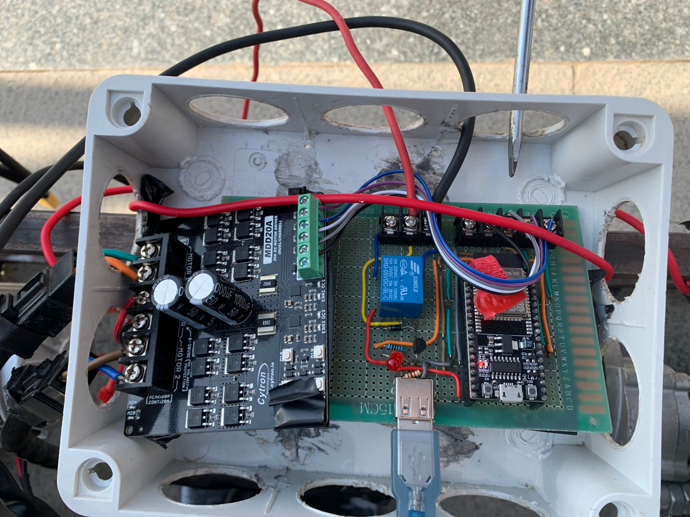

# Project History

Our team, **Vanguards**, has been working on Griffen since **2023**. These owner-supplied photos and video document the early hardware and a milestone in bringing the robot together. Specific capture dates have not been confirmed; the video transfer filename is not treated as the milestone date.

## The team

**Vanguards**, the team behind Griffen. Member names and individual roles have not yet been supplied.

## Robot before painting and later modifications

The project owner identifies this photo as the robot before it was painted and subsequently modified. It records an earlier mechanical configuration; the specific modifications and capture date have not been documented.

[View the later painted robot](../../mechanical/images/metal-monster-robot.jpg).

## Early receiver setup

The old onboard setup, identified by the project owner, shows an ESP32, relay interface, and MDD20A motor driver assembled in an enclosure. This is a historical prototype photo, separate from the [supplied receiver PCB design](../../electrical/receiver/README.md).

## Early handheld remote

The old remote used for manual control, identified by the project owner. It shows the joystick, ESP32, wiring, and buttons in a handheld enclosure. See the [remote circuit section](../../electrical/remote/README.md); the supplied remote design packages and new PCB renders are now available there.

## First integrated operation

[Watch or download the first integrated-operation video](videos/first-integrated-operation.mp4).

The project owner identifies this recording as the first time the robot worked together as a complete system. The original video is preserved without editing (9,352,735 bytes). This is a historical milestone description, not a measured performance or reliability test report. Video content has not been independently reviewed during this documentation update.

[Back to project overview](../../README.md)
