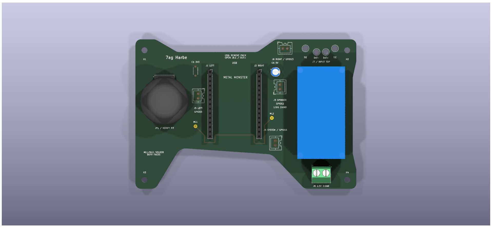
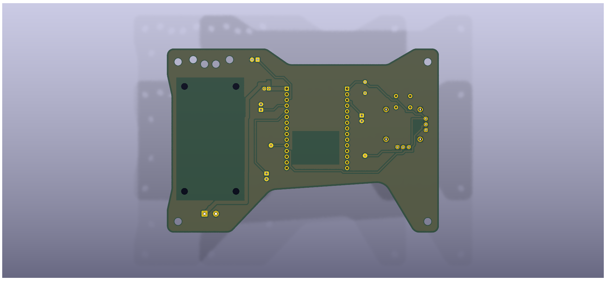

# Remote Circuit — Handheld Controller

<p align="center"></p>

The handheld controller for **Griffen**, built by **Vanguards**, communicates with the [robot receiver](../receiver/README.md) over ESP-NOW.

## Design downloads

| Package | Contents |
| --- | --- |
| [KiCad review package](source/MetalMonster_AR9_Friend_Review%20%281%29.zip) | Project, schematic, PCB, design rules, symbol and footprint libraries, and referenced models |
| [PCB mechanical package](mechanical/MetalMonster_PCB_Solid.zip) | Assembly and bare-board STEP files, outline DXFs, mechanical PDF, mounting coordinates, and supplied notes/reports |
| [Gerber package](manufacturing/MetalMonster_FINAL_GERBERS.zip) | Copper, mask, silkscreen, outline, unplated drill file, and drill-map PDF |
| [Schematic PDF](schematics/remote_schematic_avengers.pdf) | First supplied PDF |
| [Additional schematic PDF](schematics/remote_schematic_avengers%20%281%29.pdf) | Second supplied PDF; retained separately because it differs from the first |

Original filenames and archive contents are preserved. “Friend Review” and “FINAL” are supplied filenames, not independent review or fabrication approval. No authoritative revision has been inferred from the filenames.

## Board gallery

<table>
<tr>
<td align="center"><br>Top view</td>
<td align="center"><br>Underside view</td>
</tr>
</table>

[Angled render](images/remote3.png) · [Early handheld prototype](../../docs/history/images/early-remote.png)

## Package organization

```text
remote/
  README.md
  source/          Original KiCad review ZIP
  mechanical/      Original PCB STEP/DXF package
  manufacturing/   Original Gerber/drill ZIP
  schematics/      Both supplied PDFs
  images/          Three supplied PCB renders
```

The KiCad ZIP includes its local libraries and models; preserve its directory structure when extracting it. The mechanical package describes the remote PCB, not the robot chassis.

## Documentation status

The eight supplied files have been catalogued and their uploaded contents checked against the originals. The design files, PDFs, and firmware compatibility have not undergone an engineering review in this update. No electrical design or firmware changes were made.

[Transmitter firmware](../../firmware/esp-now/trans/trans.ino) · [Firmware guide](../../firmware/README.md) · [Electrical overview](../README.md)

## Mechanical section

The remote PCB STEP/DXF package is also available under [Mechanical → Remote CAD](../../mechanical/remote/README.md).
