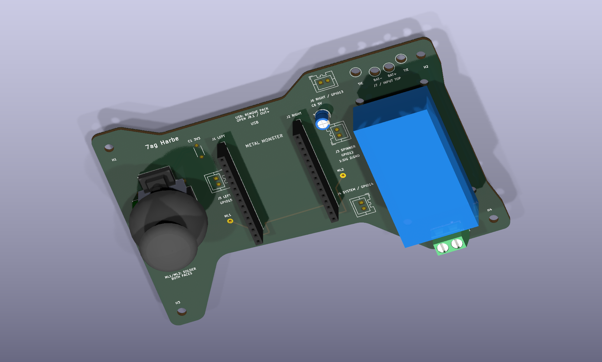

# Remote CAD Design

Mechanical references for Griffen's handheld remote, supplied by Vanguards.

[Download the remote PCB CAD package](MetalMonster_PCB_Solid.zip)

## Included files

| File | Purpose |
| --- | --- |
| `MetalMonster_PCB_Assembly.step` | PCB assembly model |
| `MetalMonster_PCB_Bare.step` | Bare PCB model |
| `MetalMonster_EdgeCuts.dxf` | Board outline |
| `MetalMonster_Outline_Holes.dxf` | Outline and hole geometry |
| `MetalMonster_Mechanical.pdf` | Mechanical drawing |
| `Mounting_Coordinates.csv` | Mounting coordinate data |
| `Clearance_Notes.txt` | Supplied clearance notes |
| `STEP_validation.json`, `DXF_validation.json` | Supplied reports |

This is the supplied **remote PCB mechanical package**. A separate handheld enclosure CAD design has not been supplied. Files and included reports are preserved as provided; dimensions, fit, and report conclusions have not been independently validated.

[Remote electrical design](../../electrical/remote/README.md) · [Mechanical overview](../README.md)

The same original ZIP remains available under the remote electrical section for convenience.
